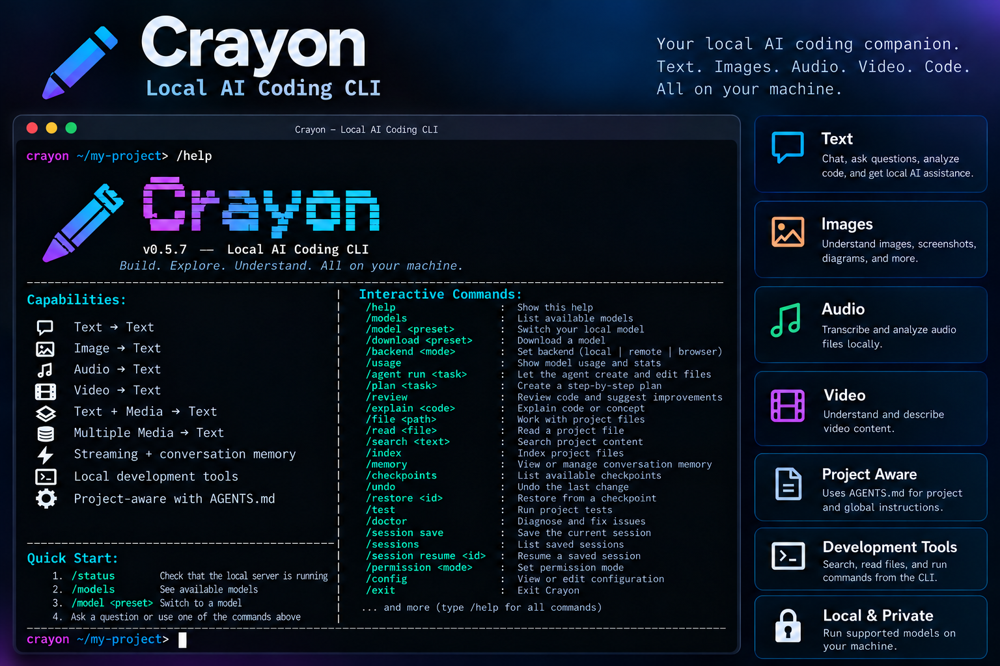

# Crayon CLI v0.5.7

### Local AI Coding CLI

Crayon is a local-first AI coding CLI designed to bring AI-assisted development directly into the terminal.

It combines a TypeScript/Node.js CLI with local AI inference, development tools, streaming responses, multimodal capabilities, project instructions, and local model management.

**Current documented release:** `v0.5.7` — Coding-Agent Workflow Improvements and Stabilization

---

## 🚀 Features

- 🤖 Local AI inference with supported local runtimes
- 🧠 Multiple model presets, including Qwen, Qwen Coder, Nemotron, and Gemma
- 🐍 Python model runtime using `llama-cpp-python` for GGUF models or Transformers for the Gemma Transformers preset
- ⚡ FastAPI inference server
- 🌊 Streaming text responses
- 🖼️ Image understanding with a compatible multimodal model
- 🎵 Audio understanding with a compatible multimodal model
- 🎥 Video understanding with a compatible multimodal model
- 🧩 Text plus media and multiple-media prompts
- 📁 Project file tools
- 💻 Terminal command execution where permitted
- 🔎 Project search and indexing
- 📝 Project instructions through `AGENTS.md`
- 🧠 Conversation/project memory
- 🔧 Runtime configuration and backend selection
- 📊 Usage information and server diagnostics
- ↩️ Checkpoints, undo, and restore workflows
- 🧪 Project test execution
- 💾 Named session save/resume
- 🔐 Restricted, approval-based, and full-access permission modes
- 🌐 Local, configured remote, and browser-based inference backends
- 🖥️ Cross-platform CLI architecture

> Model availability depends on compatible Python packages, model architecture support, hardware, and available memory. Model weights are not bundled with the project ZIP.

---

# 📦 Architecture

```text
                         ┌─────────────────────┐
                         │       Crayon        │
                         │    CLI / Terminal   │
                         └──────────┬──────────┘
                                    │
                                    ▼
                         ┌─────────────────────┐
                         │   Node.js / TS      │
                         │   Agent Runtime     │
                         └──────────┬──────────┘
                                    │
                 ┌──────────────────┼───────────────────┐
                 │                  │                   │
                 ▼                  ▼                   ▼
           File System          Terminal              Search
              Tools              Tools                Tools
                 │                  │                   │
                 └──────────────────┼───────────────────┘
                                    │
                                    ▼
                         ┌─────────────────────┐
                         │  Local AI Provider  │
                         └──────────┬──────────┘
                                    │ HTTP
                                    ▼
                         ┌─────────────────────┐
                         │   FastAPI Server    │
                         └──────────┬──────────┘
                                    │
                     ┌──────────────┴──────────────┐
                     │                             │
                     ▼                             ▼
              llama-cpp-python              Transformers
                GGUF runtime             Gemma Transformers
                     │                             │
                     └──────────────┬──────────────┘
                                    ▼
                              Local Model
```

The local backend performs inference on the user's machine. Hugging Face can supply model repository files and cached weights; the local backend does not require Hugging Face Inference Providers.

---

# 🛠️ Technology Stack

## CLI

- Node.js
- TypeScript
- npm

## Local AI Runtime

- Python
- FastAPI
- PyTorch
- Hugging Face Transformers
- `llama-cpp-python` for supported GGUF models
- Google Gemma and other configured model repositories

## Development Tools

- File-system operations
- Terminal command execution
- Project search and indexing
- `AGENTS.md` instructions
- Project/conversation memory
- Checkpoints and restore tools
- Test and diagnostic commands

---

# 🧠 Model Presets — v0.5.7

The local model server defines these presets:

| Preset | Runtime | Intended use |
|---|---|---|
| `qwen3-4b` | GGUF / `llama-cpp-python` | General chat, reasoning, and coding |
| `qwen2.5-coder-3b` | GGUF / `llama-cpp-python` | Coding assistance |
| `nemotron-3-nano-4b` | GGUF / `llama-cpp-python` | General instruction-following tasks |
| `gemma-4-e2b` | GGUF / `llama-cpp-python` | Text interaction |
| `gemma-4-e2b-transformers` | Transformers | Text and supported multimodal understanding |

The default preset defined by the server is `qwen3-4b`.

Model switching and download behavior depend on the selected preset, installed runtime, network access, model availability, and available system resources. Only one local model is intended to be loaded at a time.

## Model notes

- Model weights are not included in this repository/archive.
- Model files can require several gigabytes of disk space.
- GGUF models require a `llama-cpp-python` build that supports the model architecture.
- The Gemma Transformers preset requires compatible versions of Transformers and its dependencies.
- The four GGUF presets are documented as text-only; use the Transformers multimodal preset for the supported media commands.

---

# 💻 CLI Commands

Use `/help` in the running CLI to display commands supported by that build. The following are the main command families documented for v0.5.5.

## Models and backends

```text
/models
/model <preset>
/download <preset>
/backend <local|remote|browser>
/backend status
/status
/usage
/config
```

- `/models` lists available model presets.
- `/model <preset>` requests a local model switch.
- `/download <preset>` starts the supported model download workflow.
- `/backend <mode>` selects the local, remote, or browser backend.
- `/backend status` reports backend status.
- `/status` checks runtime/server status.
- `/usage` shows model usage and available session/recent-prompt information.
- `/config` views or edits supported configuration.

## Agent and planning

```text
/agent run <task>
/agent set <instructions>
/agent show
/agent clear
/plan <task>
/review [path]
/explain <code-or-question>
/init
/init --global
```

- `/agent run <task>` asks the agent to carry out a task.
- `/agent set`, `/agent show`, and `/agent clear` manage persistent agent instructions.
- `/plan` creates a step-by-step plan.
- `/review` reviews code and suggests improvements.
- `/explain` explains code or a concept.
- `/init` creates project instructions.
- `/init --global` creates global instructions.

## Project files and search

```text
/file <operation> <path>
/read <file>
/search <text>
/index [refresh]
/memory [show|add|clear]
```

The `/file` command supports the file operations implemented by the running build. These can include listing, creating, editing, appending, deleting, and creating directories. Review the help output for exact syntax.

## Checkpoints, tests, diagnostics, and sessions

```text
/checkpoints
/undo
/restore <checkpoint-id>
/test [command]
/doctor
/session save <name>
/sessions
/session resume <name>
```

- `/checkpoints` lists available checkpoints.
- `/undo` requests an undo of the last supported change.
- `/restore <checkpoint-id>` restores a checkpoint.
- `/test` runs the configured test command or project tests.
- `/doctor` diagnoses supported environment/runtime issues.
- `/session save <name>` saves the current session.
- `/sessions` lists saved sessions.
- `/session resume <name>` resumes a saved session.

## Media understanding

These commands require the compatible `gemma-4-e2b-transformers` preset and dependencies:

```text
/image <file> <question>
/audio <file> <question>
/video <file> <question>
/media <files> | <question>
```

The media commands analyze provided files; they do not generate images. Actual supported formats depend on the model and runtime implementation.

## Runtime and permissions

```text
/permission <restricted|approve-only|full-access>
/run <command>
/clear
/help
/exit
```

Exact command availability and argument syntax should be confirmed with `/help` in the installed build.

---

# 🔐 Permission Modes

Crayon provides three application-level permission modes:

- **`restricted`** — default mode; limits supported workspace file operations and disables shell execution.
- **`approve-only`** — asks for approval before supported file mutations or shell commands.
- **`full-access`** — permits supported file and shell operations without per-action confirmation.

These controls are not an operating-system sandbox. In `full-access` mode, commands can run with the permissions of the current operating-system account. Use the least permissive mode that fits the task, and review generated code and commands before executing them.

---

# 🌐 Inference Backends

## Local

The CLI communicates with the local Python FastAPI server. GGUF presets use `llama-cpp-python`; the Gemma Transformers preset uses Transformers. Inference runs on the machine using the configured runtime.

## Remote

The remote backend uses a configured endpoint, such as `CRAYON_REMOTE_URL`. Use an endpoint that you trust and that supports the response format expected by the CLI. A model repository URL is not the same as an inference endpoint. Remote mode sends prompts to that endpoint.

## Browser

The browser backend uses the included browser page and WebLLM/WebGPU runtime. It requires a compatible browser and WebGPU support. Browser model assets are managed by the browser and may be cached separately from Python model files.

The media commands may not be available outside the compatible local Transformers backend.

---

# 🌊 Streaming Inference

Crayon supports progressive response output through the local inference stack.

The earlier Transformers streaming architecture uses:

```text
TextIteratorStreamer
        │
        ▼
FastAPI StreamingResponse
        │
        ▼
Node.js response reader
        │
        ▼
Crayon CLI
```

Streaming availability and implementation details depend on the selected backend and model runtime.

---

# 📁 Project Instructions

Crayon supports project-level and global agent instructions through `AGENTS.md`.

Initialize instructions for the current project:

```text
/init
```

Initialize global instructions:

```text
/init --global
```

Inspect or manage active instructions:

```text
/agent show
/agent set <instructions>
/agent clear
```

Instruction behavior depends on the active project, global configuration, and the running build.

---

# 🔧 Configuration

Crayon supports environment-based configuration. Review `.env.example` and the Python server source for the exact settings supported by your archive.

Common settings documented by the project include:

```env
CRAYON_HOST=127.0.0.1
CRAYON_PORT=8765
CRAYON_MODEL_PRESET=qwen3-4b
CRAYON_CPU_THREADS=4
CRAYON_CONTEXT_SIZE=4096
CRAYON_BATCH_SIZE=512
CRAYON_MAX_NEW_TOKENS=1024
CRAYON_TEMPERATURE=0.7
CRAYON_REMOTE_URL=
```

Use values appropriate for your machine. These examples are configuration hints; the installed source and `.env.example` are authoritative if a variable differs or is not supported.

View or edit supported settings with:

```text
/config
```

---

# 🩺 Diagnostics and Troubleshooting

Check the runtime:

```text
/status
/doctor
/models
```

## Common issues

- **Python command not found:** Install Python and ensure `python` is available in `PATH`.
- **Local server unavailable:** Start the server and check the configured host and port.
- **GGUF load error:** Verify that `llama-cpp-python` is installed and supports the selected model architecture.
- **Transformers load error:** Install the Gemma requirements and verify the installed Transformers version supports the selected model.
- **Slow inference or memory errors:** Try a smaller model or reduce context size and batch size.
- **Download failures:** Check internet access, model availability, cache permissions, and free disk space.
- **Browser backend fails:** Check browser WebGPU support, drivers, and available memory.

---

# 🖥️ Supported Platforms

Crayon is designed around a Node.js/TypeScript CLI and Python runtime, with Windows, Linux, and macOS as target platforms. Exact model and dependency compatibility can vary by platform.

---

# 📦 Installation

## Run from a source checkout

Clone the repository:

```bash
git clone https://github.com/DemonicOGs/Crayon-cli.git
cd Crayon-cli
```

Install Node dependencies:

```bash
npm install
```

Build the CLI:

```bash
npm run build
```

Install the Python requirements for the runtime you plan to use.

For GGUF models, from the project root:

```bash
python -m pip install -r model/requirements-gguf.txt
```

For the Gemma Transformers runtime, from the project root:

```bash
python -m pip install -r model/requirements-gemma4.txt
```

Start the Python model server in one terminal:

```bash
python ./model/server.py
```

Start the CLI from the project root in a second terminal:

```bash
npm start
```

Keep the Python server running while using the local backend. First-time model loading may download model files and take time.

## Global installation

The original README documents this installation path:

```bash
npm install -g crayon-cli
crayon --version
crayon
```

Use this path only if the package has been published under that name and the published version includes the features described here. Otherwise, run from the source checkout above.

---

# 🛠️ Development

Typical development commands:

```bash
npm install
npm run build
npm start
```

The Python server entry point is:

```bash
python ./model/server.py
```

Review the package scripts in `package.json` for the exact available scripts.

---

# 📂 Project Structure

The archive includes the following main areas (exact files may vary by packaged build):

```text
crayon-cli/
├── src/
│   ├── agent/
│   ├── cli/
│   ├── providers/
│   └── tools/
├── dist/
│   ├── agent/
│   ├── cli/
│   ├── providers/
│   └── tools/
├── model/
│   ├── server.py
│   ├── download.py
│   ├── requirements-gguf.txt
│   └── requirements-gemma4.txt
├── browser/
├── AGENTS.md
├── package.json
├── tsconfig.json
└── README.md
```

---

# 🔐 Local-First Design and Privacy

Crayon's local workflow is designed to run inference on your own machine:

```text
Your Machine
┌──────────────────────────────────┐
│ Crayon CLI                       │
│      │                           │
│      ▼                           │
│ Local Python / model runtime     │
│      │                           │
│      ▼                           │
│ Local model files and inference  │
└──────────────────────────────────┘
```

Local inference keeps prompts within the local runtime, except for external connections needed to retrieve model files or other resources. Remote mode sends prompts to the configured endpoint. Browser mode may download model assets and run supported inference in the browser.

Permission modes help gate Crayon's supported file and shell operations but do not provide OS-level isolation.

---

# 📚 Release History

## v0.1.0 — Initial CLI Foundation

The first Crayon CLI foundation.

### Included

- Interactive CLI
- Agent architecture
- File-system tools
- Terminal tools
- Search tools
- Provider architecture
- Initial AI provider support
- CLI setup functionality

---

## v0.2.0 — Local Gemma + FastAPI + Transformers

Introduced the first local AI runtime.

### Included

- Local Gemma support
- Python model backend
- FastAPI inference server
- Transformers integration
- Local model inference
- Node.js-to-FastAPI communication

---

## v0.3.0 — Streaming Inference

Introduced real-time AI response streaming.

### Included

- `TextIteratorStreamer`
- FastAPI `StreamingResponse`
- Background model generation
- Node.js response streaming
- Progressive CLI output

---

## v0.4.0 — Multimodal AI

Expanded Crayon beyond text-only AI.

### Supported inputs

- Text
- Images
- Audio
- Video
- Text plus media
- Multiple media inputs

---

## v0.4.1 — Help UI

Introduced the structured Crayon help interface.

### Included

- `/help`
- `/status`
- `/models`
- `/clear`
- `/search`
- `/image`
- `/audio`
- `/video`
- `/run`
- `/exit`

---

## v0.5.0 — Expanded CLI

Expanded Crayon into a more complete coding-agent CLI.

### Included

- Expanded interactive commands
- Local AI workflow improvements
- Development tools
- Multimodal commands
- Conversation handling
- Model/server interaction
- Improved CLI structure

---

## v0.5.1 — AGENTS.md Support

Introduced project-level and global agent instructions.

### Included

- `AGENTS.md`
- Project instructions
- Global instructions
- `/init`
- `/init --global`
- `/agent`
- Automatic instruction injection

### Instruction hierarchy

```text
Global Instructions
        │
        ▼
Project Instructions
        │
        ▼
Current Project
        │
        ▼
AI Agent
```

---

## v0.5.2 — Local Server Management

Improved local model-server management and diagnostics.

### Included

- Local server startup
- Server readiness detection
- Health checks
- Model discovery
- Server diagnostics
- `/status`
- `/models`
- `/clear`
- Configurable host/port
- Server startup control

The original release documentation listed these server environment variables:

```env
AGY_HOST=127.0.0.1
AGY_PORT=8765
AGY_START_SERVER=true
```

Use the variables actually supported by your current `.env.example` and server source.

---

## v0.5.3 — Local Runtime Stabilization

Focused on stabilizing the local Gemma runtime and finalizing the CLI help experience.

### Included

- Local Gemma runtime improvements
- FastAPI runtime stabilization
- Provider improvements
- Server communication fixes
- Streaming improvements
- Finalized help UI
- Improved local inference reliability

### Documented capabilities

```text
Text → Text
Image → Text
Audio → Text
Video → Text
Text + Media → Text
Multiple Media → Text
```

---

## v0.5.4 — Expanded Development Commands

Introduced additional CLI functionality.

### New commands

```text
/config
/media
/read
```

Along with existing commands such as `/help`, `/status`, `/models`, `/clear`, `/init`, `/agent`, `/search`, `/image`, `/audio`, `/video`, `/run`, and `/exit`.

The release also cleaned up the help interface and removed the old fake “One-shot” section.

---

## v0.5.5 — Local Model Presets + Coding-Agent Workflow

Expanded Crayon's local-first architecture with multiple model presets and a broader set of coding-agent tools.

### Included

- Five local model presets:
  - `qwen3-4b`
  - `qwen2.5-coder-3b`
  - `nemotron-3-nano-4b`
  - `gemma-4-e2b`
  - `gemma-4-e2b-transformers`
- GGUF inference through `llama-cpp-python` and a Transformers runtime for Gemma.
- Local model discovery, download, and switching commands.
- Streaming inference through the Python FastAPI server.
- Agent task execution and persistent agent instructions.
- Project file tools, code search, project indexing, and project memory.
- Checkpoints, undo/restore workflows, test execution, and diagnostics.
- Session save and resume commands.
- Permission modes: `restricted`, `approve-only`, and `full-access`.
- Local, configured remote, and browser-based inference backends.
- `/usage` for model usage and session/recent-prompt information.
- Updated terminal dashboard and Quick Actions layout.
- Multimodal image, audio, video, and multiple-media understanding with the compatible Gemma Transformers preset.

### Model and runtime notes

- Model weights are not bundled with the project and may be downloaded or cached on first use.
- GGUF support depends on the installed `llama-cpp-python` build supporting the selected model architecture.
- The Gemma Transformers preset requires compatible Transformers dependencies and sufficient system resources.
- Permission modes are application-level controls, not an operating-system sandbox.
- Actual command availability and model compatibility should be checked in the installed build.

---

## v0.5.6 — Agent Workflow, Git Tools + Project Intelligence

Expanded the coding-agent workflow and project-level development tools.

### Documented additions

- Improved autonomous agent task execution and task handling.
- Git-oriented review and rollback workflows.
- Incremental project indexing improvements.
- Model management and session recovery improvements.
- Architecture and impact analysis helpers.
- Patch review and affected-test workflows.
- Debugging and error-explanation helpers.
- Evaluation/reporting support.

Feature availability depends on the exact source build and its configuration. Confirm command syntax with `/help`.

---

## v0.5.7 — Maintenance, Stabilization + Compatibility

Continued work on the v0.5.6 codebase with a focus on maintaining the existing CLI and local inference architecture.

### Release notes

- Retains the TypeScript/Node.js CLI and Python FastAPI inference server architecture described in this README.
- Retains the local model presets and coding-agent capabilities documented for v0.5.5, subject to the installed build.
- Treats the v0.5.7 source tree as the baseline for subsequent packaging and Python-CLI migration experiments.

**Important:** The Python-only CLI migration was a separate experimental workstream and should not be interpreted as a completed, feature-parity replacement for the v0.5.7 TypeScript CLI.

---

# 📜 Version Timeline

```text
v0.1.0  ── Initial CLI Foundation
   │
v0.2.0  ── Local Gemma + FastAPI + Transformers
   │
v0.3.0  ── Streaming Inference
   │
v0.4.0  ── Multimodal AI
   │
v0.4.1  ── Help UI
   │
v0.5.0  ── Expanded CLI
   │
v0.5.1  ── AGENTS.md Support
   │
v0.5.2  ── Local Server Management
   │
v0.5.3  ── Local Runtime Stabilization
   │
v0.5.4  ── Expanded Development Commands
   │
v0.5.5  ── Local Model Presets + Coding-Agent Workflow
   │
v0.5.6  ── Agent Workflow, Git Tools + Project Intelligence
   │
v0.5.7  ── Maintenance, Stabilization + Compatibility
```

---

# 📋 Release Summary

| Version | Release |
|---|---|
| `v0.1.0` | Initial CLI Foundation |
| `v0.2.0` | Local Gemma + FastAPI + Transformers |
| `v0.3.0` | Streaming Inference |
| `v0.4.0` | Multimodal AI |
| `v0.4.1` | Help UI |
| `v0.5.0` | Expanded CLI |
| `v0.5.1` | AGENTS.md Support |
| `v0.5.2` | Local Server Management |
| `v0.5.3` | Local Runtime Stabilization |
| `v0.5.4` | Expanded Development Commands |
| `v0.5.5` | Local Model Presets + Coding-Agent Workflow |
| `v0.5.6` | Agent Workflow, Git Tools + Project Intelligence |
| `v0.5.7` | Maintenance, Stabilization + Compatibility |

---

# 📄 License

See the `LICENSE` file included with the project.

---

## Crayon

**Local AI. Coding. Tools. One CLI.**

```text
CRAYON
Local AI Coding CLI
v0.5.7
```
